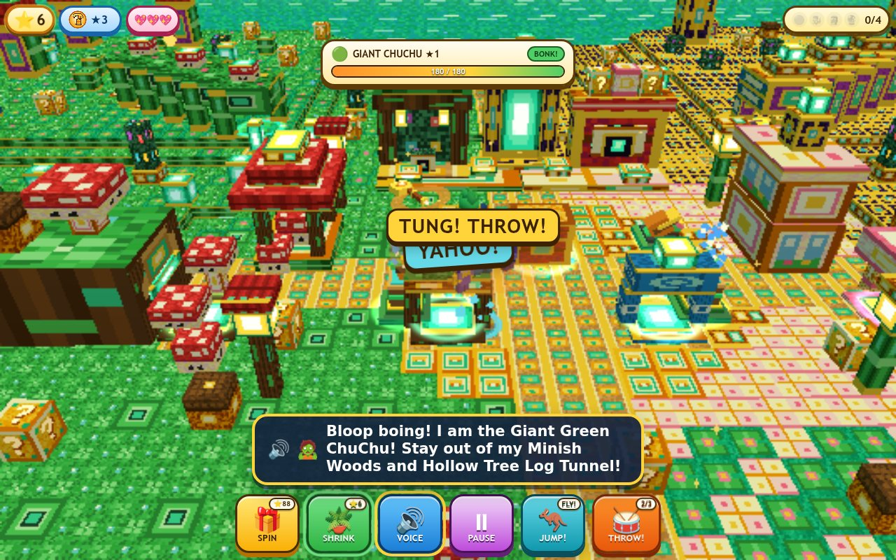

# 🍄✨ HUNTR/X & Smiling Critters: The Minish Cap 3D!

**Live Game (GitHub Pages):** [https://kunruiw1991.github.io/huntrix-critters-minish-cap-3d/](https://kunruiw1991.github.io/huntrix-critters-minish-cap-3d/)

A kid-friendly (Age 5+) 3D WebGL2 (*Three.js r170*) size-shifting adventure inspired by **[Bilibili BV13c411b7ee — *The Legend of Zelda: The Minish Cap* (塞尔达传说：缩小帽)](https://www.bilibili.com/en/video/BV13c411b7ee/?spm_id_from=333.337.search-card.all.click)** combined with **KPop Demon Hunters (HUNTR/X Rumi, Mira, Zoey, Derpy Tiger & Ezlo × Sussie Bird-Billed Minish Cap)** and **Smiling Critters (CatNap, DogDay, Hoppy Hopscotch & Bobby BearHug)**!

---

## ✨ Key Features

1. **Easy-to-Reach Minish Shrink Portals (`SHRINK_PORTALS` — 1-Tap & Proximity Size-Shifting)**
   - **6 Oversized Glowing Shrink Portals** placed right beside the Hub spawn and at the mouth of every Tiny Passage so young players can effortlessly switch between **Big Hero Size (`1.0x`)** and **Minish Picori Size (`0.34x`)**:
     - `hub_stump` (`-3.2, 2.2`): **Magic Shrink Tree Stump** right beside Hub spawn
     - `hub_jar` (`+3.2, 2.2`): **Tipped Porcelain Minish Jar** right beside Hub spawn
     - `west_log_stump` (`-11.2, 1.5`): **Deepwood Acorn Shrink Stump** at the West Hollow Log entrance
     - `east_mousehole_cup` (`+11.2, 1.5`): **Bakery Teacup Shrink Portal** at the East Mousehole entrance
     - `nw_lily_stone` (`-11.2, -10.8`): **Dewdrop Lily Shrink Stone** at the NW Bamboo Pipe entrance
     - `ne_clockwork_altar` (`+11.2, -10.8`): **Wind Ruins Kinstone Shrink Altar** at the NE Clockwork Tunnel entrance
   - **Multiple Kid-Friendly Ways to Shrink & Grow**:
     - Tap any glowing **Tree Stump** or **Tipped Minish Jar** in the 3D world
     - Tap a **Tiny Passage** directly (automatic **Ezlo Cap Shrink-Assist** shrinks the squad to `0.34x` and walks right through!)
     - Press `M` or `C` on the keyboard
   - **Minish Micro-Perspective Camera**: When shrunk to `0.34x`, the camera smoothly zooms in and lowers its pitch so tree stumps, clover blades, acorns, and teacups tower overhead like giant landmarks (`camera.rotation.z === 0`).

2. **4 Dedicated Tiny-Only Micro-Passages (`TINY_PASSAGES`)**
   - Each passage has low overhead clearance (`1.1` blocks) that blocks Big (`1.0x`) heroes (`blockedBySize: true`) and opens into a glowing interior secret shortcut when Tiny (`0.34x`), rewarding **+18 Star Gems** and **+1 Magic Acorn Seed** on discovery:
     1. **Giant Hollow Fallen Oak Tree Trunk & Acorn Micro-Tunnel (`hollow_log_tunnel`)** — West (`(-12.0, 1.5) -> (-15.5, 1.5) -> (-19.0, 1.5)`) into Deepwood Shrine
     2. **Giant Bakery Baseboard Mousehole Archway & Teacup Rafters (`dollhouse_mousehole_tunnel`)** — East (`(12.0, 1.5) -> (15.5, 1.5) -> (19.0, 1.5)`) into Hyrule Town Giant Bakery
     3. **Giant Lily-Pad Stepping Bridge & Hollow Emerald Bamboo Pipe (`lilypad_bamboo_tunnel`)** — North-West (`(-12.0, -11.5) -> (-15.5, -14.0) -> (-19.0, -16.5)`) into Trilby Highlands Dewdrop Pond
     4. **Giant Leaning Spellbook Crack & Golden Clockwork Gear Tunnel (`bookshelf_gear_tunnel`)** — North-East (`(12.0, -11.5) -> (15.5, -14.0) -> (19.0, -16.5)`) into Royal Library & Wind Ruins

3. **HUNTR/X × Smiling Critters Minish Cap Squad (`src/chars/hero.js` & `src/chars/critters.js`)**
   - **Derpy Tiger** (preserving his signature round Korean Minhwa face `skullMesh`/`muzzleMask` and twin round butt spheres `buttL`/`buttR`) wearing the **Emerald & Gold Ezlo × Sussie Bird-Billed Minish Cap** (`sussieGroup`), flanked by **Smiling Critters CatNap & DogDay** and **HUNTR/X Rumi**, plus 8 walking Smiling Critters & HUNTR/X Minish buddies (**CatNap**, **DogDay**, **Hoppy Hopscotch**, **Bobby BearHug**, **HUNTR/X Mira**, and **HUNTR/X Zoey**).

4. **5 *Minish Cap* Weapons & 4 Size-Mechanic Bosses (`BV13c411b7ee`)**
   - **Weapons**: `★1 Picori Short Sword`, `★2 Magical Gust Jar`, `★3 Cane of Pacci`, `★4 Digging Mole Mitts`, and `★5 Four Sword Golden Blade`.
   - **Bosses**: `GIANT CHUCHU ★1` (Deepwood Shrine), `GLEEROK DRAGON ★2` (Cave of Flames), `MAZAAL GOLEM ★3` (Fortress of Winds), and `VAATI SORCERER ★4` (Dark Hyrule Castle).
   - **68 Pre-Recorded Neural Voiceover MP3s** (`assets/voice/manifest.json`) with automatic `-6 dB` BGM ducking and 1-tap replay.
